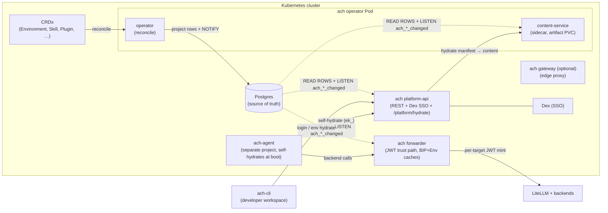

# ACH — Agent Capability Hub

Multi-service Kubernetes control plane for managing AI agent configurations:
operator + platform API + forwarder + content service + CLI. The long-running
services ship as a single Go binary (`ach`) with cobra subcommands; the
user-facing CLI ships as a separate `ach-cli` binary (login/whoami/logout/
config/env/keys/hydrate/admin).

## Quick start

Once the Hub is deployed and reachable at `https://ach.local.test` (the
standard kind+Helm fixture host — see `deploy/helm/ach/values.yaml` for
the `ACH_BASE_URL` default and `examples/04-environment-demo.yaml` for
the `demo` Environment the example uses):

```bash
ach-cli login https://ach.local.test           # one-time SSO (browser or device code)
ach-cli env hydrate demo --raw > hydrate.json
```

The `hydrate.json` byte output reproduces `examples/hydrate.json`
verbatim against the standard fixture cluster (modulo platform-api
host substitution; the CLI e2e suite normalizes this automatically —
see `test/e2e/cli_login_hydrate_test.go`). See `examples/README.md`
for the full demo walkthrough.

## Architecture



## Quick links

- [Documentation](https://ackstorm.github.io/ach/)
- [Installation](https://ackstorm.github.io/ach/getting-started/installation/)
- [Architecture](https://ackstorm.github.io/ach/developer-guide/architecture/)
- [Release process](https://ackstorm.github.io/ach/developer-guide/release-process/)
- [CONTRIBUTING](CONTRIBUTING.md)
- [SECURITY](SECURITY.md)
- [MAINTAINERS](MAINTAINERS.md)
- [CHANGELOG](CHANGELOG.md)

## License

ACH is open core. Everything outside `ee/`, `ui/src/ee/` and `cmd/ach/ee.go` is licensed under
[Apache-2.0](LICENSE). The Enterprise code (`ee/`, `ui/src/ee/`, `cmd/ach/ee.go`), included in the
`ghcr.io/ackstorm/ach` image and enabled with Helm `enterprise.enabled`, is licensed under the [ACKstorm Enterprise
License](ee/LICENSE): production use requires an agreement with ACKstorm.
See also [NOTICE](NOTICE).
